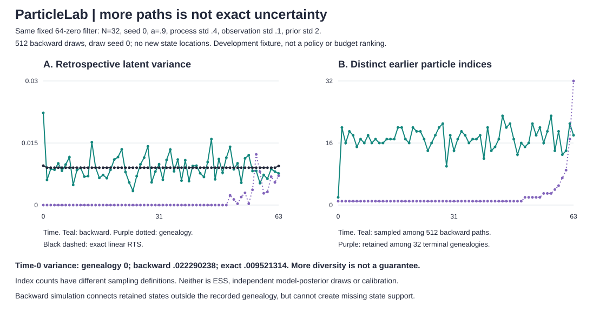

# Backward simulation does not create missing state support

`backward` samples trajectories by combining the retained filtering populations with the model's transition density. It can connect earlier and later states outside the recorded parent maps. This differs from `smooth`, which can only trace existing genealogies. The sampled states still come from the finite filtering populations; backward simulation cannot invent an absent state value.

## Run and scope

```sh
python -m particlelab backward examples/sequence.json --particles 32 --draws 512 --seed 0 --draw-seed 0
python examples/backward_audit.py > /tmp/backward-audit.json
python examples/render_backward.py /tmp/backward-audit.json --check
```

API: `backward_smoother(data, draws=256, draw_seed=0, **filter_settings)` from `particlelab`. Every command uses the same six-field model payload as `filter`. `--seed` controls the filter; `--draw-seed` independently controls backward simulation. Changing the latter never changes the filter. Linear and square observations are supported, but the exact RTS reference is linear only.

Process std must be in **[1e-4,100]** for this method, a deliberately narrower domain than the base filter's [0,100]. A deterministic transition has no Gaussian density of the form used below. It is rejected, not approximated with an arbitrary epsilon or silently assigned zero probability. This restriction also applies to one-observation input for a consistent method contract.

Draws must be an integer 1..1024; draw seed an integer 0..2^32-1. `N*T*draws <= 2097152`, checked before filtering, bounds candidate work. Existing model and `N*T <= 65536` caps remain. Invalid payloads, limits and flags exit 2 with prefixed stderr and no traceback. No paid service receives the input.

## Finite backward law

Let `x[t,i]`, `log_w[t,i]` be the pre-resampling filtered particles and normalized log weights. For each trajectory:

1. Draw a terminal index with the terminal **filtered** probabilities. Do not use its resampled/carried population.
2. Given the selected next state z, draw an earlier index with mass proportional to `w[t,i] * Normal(z; a*x[t,i], q²)`.
3. Repeat through time 0. Record the selected filtered index and state at every time.

No parent-map constraint is imposed. There is no extra process-noise draw or state mutation. Each draw uses fresh categorical uniforms from the separate local RNG. On a fixed retained filter, this is simulation from its finite backward-kernel law, not exact sampling from the original model posterior. Unconditionally, all paths share the same random filter approximation.

The Gaussian normalizing constant cancels within each kernel. The code also subtracts one candidate's squared-residual term algebraically before normalization. With reference state c, use `base=(z-a*c)/q` and `delta_i=a*(x[t,i]-c)/q`:

```text
log_kernel_i = log_w[t,i] + base*delta_i - delta_i²/2
```

This equals the usual log kernel up to a shared constant. It avoids allowing a huge common residual to erase small filtered-weight differences. In particular a=0 must reproduce the filtering weights even for extreme z. Log-sum-exp normalization retains finite filtered log weights: a candidate whose stored filtering probability underflowed to zero can regain representable backward mass after conditioning on z. Probabilities may still underflow after normalization, and floating-point cancellation remains a limit. There is no arbitrary probability floor.

Categorical bins are right-open. An exact CDF boundary skips to the following positive-mass bin; zero bins are never selected. A tail-roundoff fallback chooses the last positive bin, not a zero-mass tail.

## Output and interpretation

- `filter`: the unchanged complete underlying filter run.
- `draw_settings`: draw count/seed and candidate budget/limit.
- `trajectories` and `index_trajectories`: equally weighted sampled state/index paths, each in chronological order.
- `index_path_log_probabilities`: sums of selected terminal and conditional log probabilities. These are **discrete index-path masses conditional on this filter**, not continuous trajectory densities or marginal state probabilities. Duplicate state paths can have different indices; their masses are not combined.
- `smoothing_history`: empirical means, population variances, sign masses, distinct sampled indices and distinct sampled states at every time.

Population variance divides by the number of draws. It is a sample summary, not an unbiased estimator of posterior variance. A single draw has variance 0, which is not certainty. Constant sampled states are returned with exactly zero variance rather than a rounding residual. Distinct sampled-index counts depend on draw count and weights; they are neither particle ESS nor the number of independent model-posterior samples.

Time is `O(T*N + draws*T*N)`, with retained filter memory `O(T*N)`, returned paths `O(draws*T)` and `O(N)` temporary kernel storage. Larger draw counts reduce only simulation noise in this fixed finite approximation; they do not improve the retained filter populations.

## Same-filter development comparison

This reuses the unchanged genealogy-collapse fixture: 64 zeros, a=.9, process std=.4, observation std=.1, prior mean 0/std 2, N=32, filter seed 0, ESS threshold fraction 1. The new draw settings are 512 paths, draw seed 0, the first inspected setting. No new seed/budget tuning or held-out evaluation was performed.

| Time-0 quantity, using all 64 observations | Retained genealogy | Backward simulation | Exact linear RTS |
|---|---:|---:|---:|
| Mean | -.144240045570 | -.022238567581 | 0 |
| Latent variance | 0 | .022290237629 | .009521314035 |
| Distinct earlier particle indices | 1 retained | 2 sampled | not applicable |

Backward simulation reaches two earlier states instead of one recorded path. Its variance is still **over twice** the exact variance. This is not repaired uncertainty or calibrated coverage. Both approximations are limited by the original finite state support. The filter is exactly identical in both arms; nevertheless, this one finite fixture is not a general algorithm ranking or accuracy guarantee.

At the terminal time, the genealogy result is the weighted filtering marginal; the backward result is a categorical sample from it. Their empirical moments need not be identical. The 512 sampled terminal indices cover 18 of the 32 retained indices. The count difference does not show lower effective sample size or loss of posterior support.



The figure plots all 64 times for three variance curves and two distinct-index curves, 320 points in total. Index curves use different sampling definitions: retained ancestors among 32 terminal genealogies versus distinct sampled indices among 512 backward paths. They are not an ESS comparison. Complete settings, domains, endpoint diagnostics and every plotted value are in SVG metadata. Fixed-domain/fixture checks reject missing, changed or out-of-range values instead of clipping.

## Validation and limits

Eighteen new tests bring the suite to **92**. Tests verify direct Gaussian-kernel products, recovery of underflowed filtering mass, huge common-residual cancellation, right-open CDF/zero bins, and all nine possible index paths of a tiny two-time/three-particle filter against separately computed probabilities. They also check manual empirical moments and retained support, draw-seed/filter separation, no parent-map constraint, terminal filtered weights, RNG isolation, draw-prefix consistency, mutation isolation, single-draw summaries, square/negative transitions, strict limits before filtering, CLI routes and all 320 figure coordinates/values.

Backward simulation is optional, bounded and scalar. It does not add state support, rejuvenate the filter, learn parameters, estimate Monte Carlo error or provide a convergence, coverage or real-data guarantee. The square option has no exact dynamic nonlinear reference. Particle approximation error and backward simulation noise are different sources of error. All quantities use finite floating point and a local pseudorandom generator.

Independent implementation of the standard forward-filtering backward-simulation method. Technical reference: Särkkä and Svensson, *Bayesian Filtering and Smoothing*, second edition (2023), section 15.2, Algorithm 15.2. [Author-hosted reference](https://users.aalto.fi/~ssarkka/pub/bfs_book_2023_online.pdf). No source text, code or figures copied.
