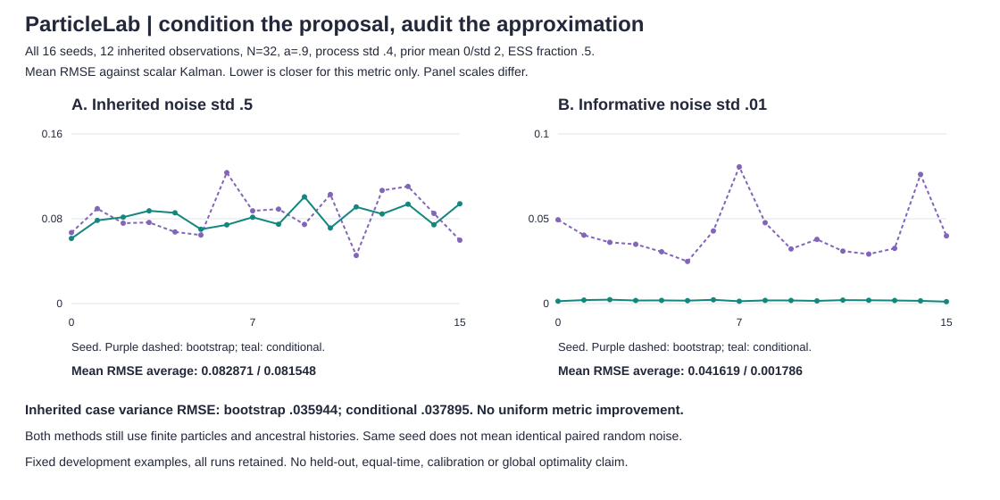

# Condition on the observation before drawing particles

`filter --proposal conditional` adds an observation-conditioned Gaussian proposal for the scalar **linear identity-observation model only**. The bootstrap proposal remains the default, with unchanged existing demo output. This is a different proposal, not a learned transition, model change, auxiliary ancestor-selection filter or repair of existing retained states.

```sh
python -m particlelab filter examples/sequence.json --particles 32 --seed 0 --proposal conditional
python -m particlelab filter examples/sequence.json --particles 32 --seed 0 --proposal bootstrap
python examples/proposal_audit.py > /tmp/proposal-audit.json
python examples/render_proposal.py /tmp/proposal-audit.json --check
```

Python: `filter_particles(data, proposal='conditional', **settings)`. The six-field JSON input and existing resource limits are unchanged. `--proposal` is a `filter` flag; the `smooth`/`backward` CLI commands keep their existing bootstrap behavior. Their Python APIs forward `proposal='conditional'` through filter settings if supplied, with the backward sampler's separate process-noise/work limits still in force.

## One conditional Gaussian per ancestor

Write Q=q², R=r², with supplied fixed model parameters. For t>0 and a carried ancestor z, the prior transition is Normal(a*z,Q) and the likelihood is Normal(y;x,R). The identity

```text
p(x|z) * p(y|x) / p(x|z,y) = p(y|z)
```

makes the importance correction independent of the newly drawn state when z is fixed. With m=a*z:

```text
S = Q + R
K = Q / S
proposal_mean = m + K*(y-m)
proposal_variance = (1-K)^2*Q + K^2*R
log_predictive = -.5 * [log(2*pi*S) + (y-m)^2/S]
unnormalized_log_weight = incoming_log_weight + log_predictive
```

The Joseph-form variance equals Q*R/(Q+R) algebraically and avoids subtracting nearly equal numbers. Draw x from this proposal, then normalize the predictive importance weights. **Do not multiply by the observation likelihood again.** The tests verify the Gaussian density ratio independently at several state values.

At t=0 there is no transition. Replace m,Q by the initial mean/variance, draw from the exact initial conditional, set all weights to 1/N and use the analytic initial predictive density as the evidence increment. Even one particle has this exact initial evidence in floating point, but one sampled state still has empirical variance zero and does not represent exact uncertainty.

At Q=0, K=0 and the proposal is the deterministic state a*z. No later Gaussian draw or invented process noise is used. The predictive correction becomes the observation likelihood at a*z. This is a degenerate measure, not a positive-variance transition-density formula. Squared process std can also underflow to zero at extreme tiny positive inputs; floating-point output follows the resulting zero variance. This forward proposal accepts q=0; the separate `backward` sampler still rejects process std below 1e-4.

## What "optimal" does and does not mean

The standard conditional proposal minimizes the incremental importance-weight variance **conditional on a fixed ancestor and the current observation**, under the specified model and mathematical arithmetic. Here its correction has no variation with the new conditional draw. It does not make predictive weights equal across different ancestors. This implementation does not reselect ancestors using predictive weights before propagation, so it is not a fully adapted auxiliary filter.

Finite populations, ancestry loss and resampling dependence remain. Normalized particle moments are still approximations, even though this model also has an exact Kalman solution. This is a pedagogical particle proposal, not an argument to replace Kalman filtering for a scalar linear-Gaussian model. There is no claim of global variance optimality, lower wall-clock cost, unbiased log evidence, calibrated intervals, robustness or better results on every metric.

## Complete fixed-seed development comparison

Both experiments retain the existing twelve observations, a=.9, process std=.4, initial mean=0/std=2. N=32, ESS threshold fraction=.5 and **all seeds 0..15** were fixed before inspecting these new results. The first keeps the inherited observation std .5; the second uses .01 to illustrate informative observations. No other noise levels, seeds or particle counts were searched for this comparison. Both are development examples, not untouched test data.



The figure shows every per-seed mean RMSE versus scalar Kalman, not one selected run. **Panel scales differ:** [0,.16] for std .5 and [0,.1] for std .01. Seed order is not time. The complete per-seed metrics, settings, fixed domains and selection note are embedded in the SVG metadata and emitted by the audit command.

The following are means of per-run metrics, not pooled errors or confidence intervals. Min ESS means each run's minimum **filtered** weight ESS over time, averaged over seeds. Log-evidence error is signed estimated log evidence minus exact log evidence.

| Observation std / proposal | Mean RMSE | Variance RMSE | Log-evidence error | Mean minimum ESS |
|---|---:|---:|---:|---:|
| .5 / bootstrap | .0828713785 | .0359440473 | -.0467106276 | 10.0684309 |
| .5 / conditional | .0815484260 | .0378945690 | +.0245000421 | 14.0658674 |
| .01 / bootstrap | .0416192831 | .0002889767 | -111.5785506 | 1 |
| .01 / conditional | .0017855306 | .0000231947 | +.0029966538 | 31.7938586 |

**There is no uniform improvement:** at inherited std .5, conditional variance RMSE is worse (.037895 versus .035944), while mean RMSE is similar. The .01 example has much smaller conditional mean and variance errors on these runs, but neither result is a general method ranking or calibration evidence.

Average resampling counts are 4.5/1.0 (bootstrap/conditional) at std .5 and 12/0 at std .01. Average terminal initial-label counts are 5.875/18.5625 and 1/32 respectively. These are raw retained ancestor-label counts, not a posterior accuracy or smoothing guarantee. Full carried ESS is not used as a success condition.

The two methods share seed labels, **not a fixed paired noise stream**: proposal parameters differ, and different resampling decisions consume the local RNG differently. This comparison changes both initial conditioning and later proposal/weight formulas. It does not isolate one of those changes. There is no measured equal-time or equal-random-draw benchmark, and no superiority threshold in the audit: only seed completeness and finite-metric checks.

## Output and validation

Conditional histories keep all existing filtered/carried states, weights/log weights, parent/root mappings, moments/sign masses, ESS, resampling decisions and evidence increments. Three additional arrays align with each incoming particle slot: `proposal_means`, `proposal_variances`, `log_predictive_likelihoods`. They describe **before-resampling** proposals, not returned posterior standard deviations. Settings identify `proposal: conditional`; default bootstrap settings/output remain unchanged.

For conditional weights, finite normalized log weights are calculated from peak-centered raw weights, rather than subtracting a huge absolute normalizer. Initial equal log weights are assigned directly. Stored probabilities can still underflow; finite logs can revive relative mass only while resampling is skipped. Resampling discards zero-mass paths and cannot revive them later. Floating-point cancellation in extreme log terms is not eliminated in general.

**114 tests** include independent precision-form conditional moments, transition-times-likelihood/proposal density identities, exact initial predictive evidence, a hand-worked two-step predictive-weight calculation, full no-resampling predictive products, q=0 draw counts and deterministic states, a=0 exact evidence at every step, probability-underflow revival, extreme inputs, parent/root maps, RNG/input isolation, CLI rejection of square observations and unchanged default output. Python smoother integration and all 64 new figure point values/coordinates, four polylines, complete metadata and byte-identical regeneration are checked. All previous demos and four SVGs remain unchanged. CI runs Python 3.10..3.13 plus the five reproducible figures.

The same limits apply: T=1..80, N=1..4096, N*T<=65536; finite model parameters in the README's stated ranges. Time, full-history memory and output stay O(N*T), with three more per-particle arrays for this proposal. No higher-dimensional model, parameter fitting or nonlinear observation approximation is supplied. No external service receives the input.

## Attribution

Independent scalar implementation of standard sequential importance sampling with the observation-conditioned proposal. [Särkkä and Svensson, Bayesian Filtering and Smoothing, second edition (2023), section 11.5, equation 11.37](https://users.aalto.fi/~ssarkka/pub/bfs_book_2023_online.pdf) identifies the optimal conditional importance distribution. The scalar conditioning/evidence formulas here are derived for this repository's model. No source text, code, data or figures were copied. MIT license.
