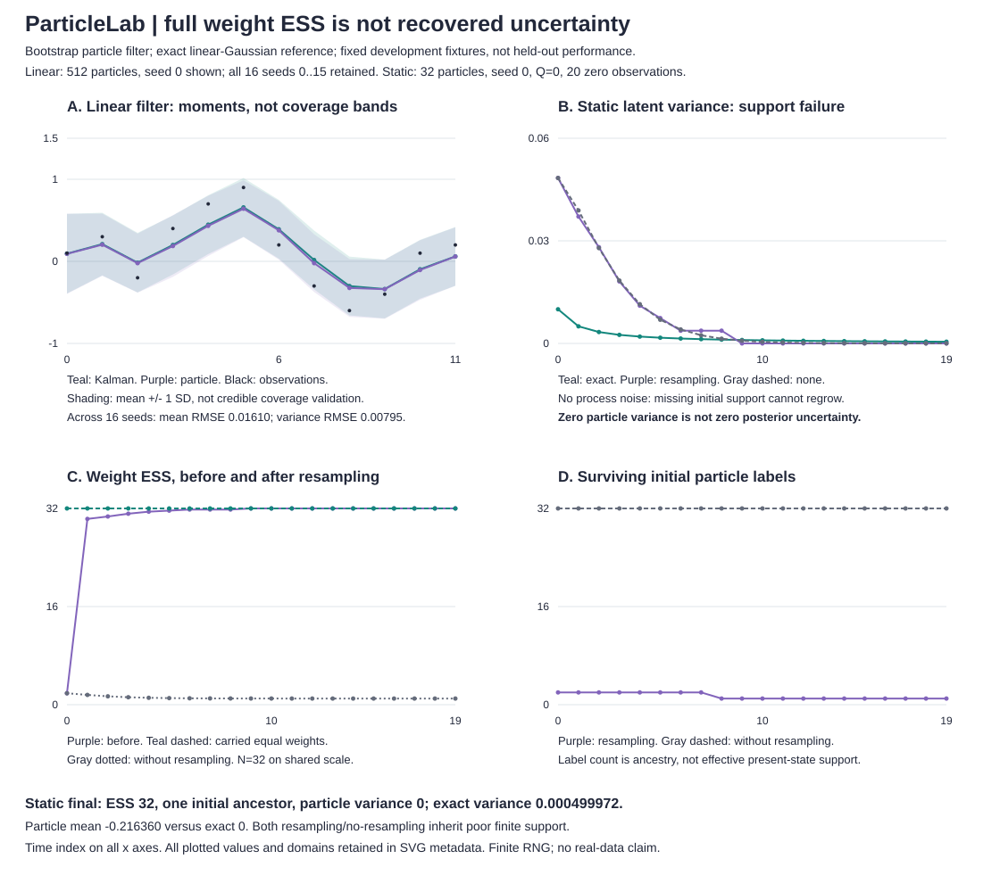
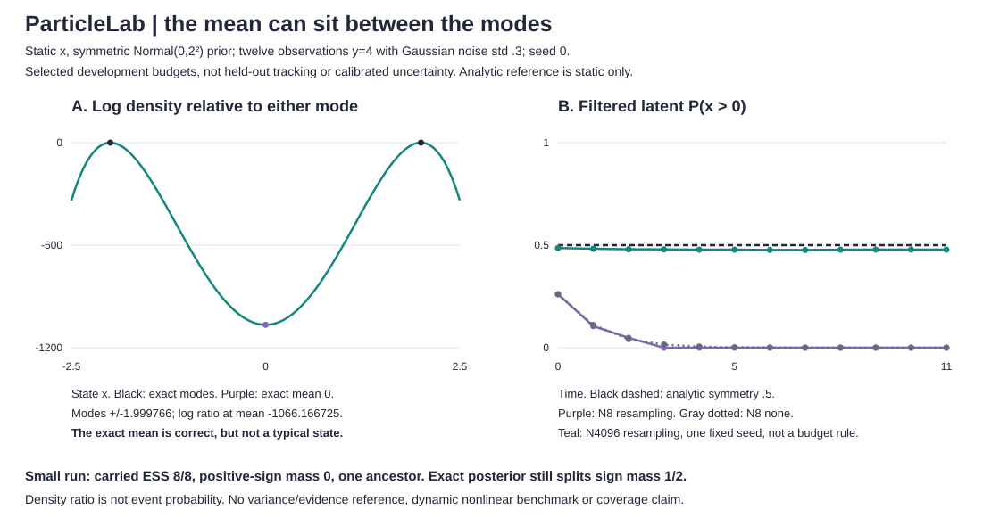
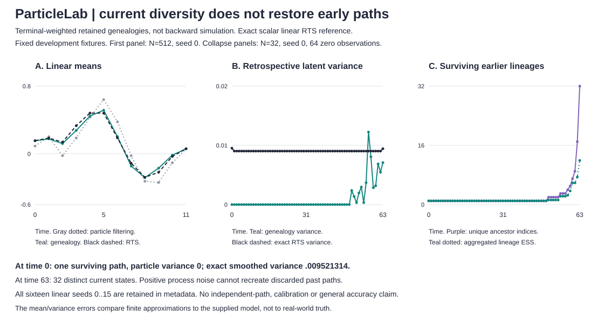

# ParticleLab

**Full weight ESS does not mean recovered uncertainty.** A bootstrap particle filter from scratch, with log-domain weights, systematic resampling, complete weighted/carried particle histories, initial-ancestry audits and an exact scalar Kalman reference. Dependency-free Python 3.10+; no paid API, GPU or data download.



The static example ends with weight ESS 32 out of 32, one initial ancestor and zero particle variance. The exact posterior still has variance .000499972. Resampling resets weights, not missing state support. A no-resampling comparison exposes the same poor initial finite support; this is not a claim that resampling alone causes the error.

## Run locally

From the repository root:

```sh
python -m unittest discover -s tests -v
python -m particlelab demo > /tmp/particle-demo.json
python examples/render_demo.py /tmp/particle-demo.json --check
python -m particlelab filter examples/sequence.json --particles 512 --seed 0
python -m particlelab filter examples/sequence.json --ess-fraction 0
python -m particlelab kalman examples/sequence.json
python -m particlelab filter --help
```

Every model command reads exactly these six JSON fields:

```json
{
  "data": [0.1, 0.3, -0.2, 0.4, 0.7, 0.9, 0.2, -0.3, -0.6, -0.4, 0.1, 0.2],
  "a": 0.9,
  "process_std": 0.4,
  "observation_std": 0.5,
  "initial_mean": 0.0,
  "initial_std": 2.0
}
```

`filter` also accepts `--observation square`, meaning h(x)=x² rather than x. `kalman` is only the linear identity-observation reference. `square-reference` provides restricted static symmetry/mode checks from `examples/square.json`; it rejects a!=1, process_std!=0 or initial_mean!=0. This is not a dynamic nonlinear tracking reference. `demo` needs no file. Output is JSON; invalid inputs exit 2 with a prefixed stderr error and no traceback. Python APIs are `filter_particles`, `kalman` and `systematic_resample` from `particlelab`. `genealogy_smoother` and `rts` are separate retrospective APIs.

## Explicit model and timing

- Initial x₀ ~ Normal(initial_mean, initial_std²). The first observation updates this distribution directly: **there is no initial transition**.
- For t>0, `xₜ = a*xₜ₋₁ + Normal(0, process_std²)`, with independent process noise. Process std may be zero.
- yₜ | xₜ ~ Normal(h(xₜ), observation_std²), with supplied fixed noise. h is identity or square.
- For the default bootstrap method, the transition is the proposal. Weight each propagated particle by its observation likelihood and incoming normalized weight. The log normalizer is the next evidence increment.
- Normalize in log space. Retain finite normalized log weights across skipped resampling even if their stored probabilities underflow to zero. A later observation can revive such a particle's relative mass.
- If weight `ESS < N*ess_fraction`, resample with one systematic offset and reset carried weights to 1/N. The inequality is strict; fraction 0 disables resampling. Finite rounding can matter near the threshold.

The `filter` command targets p(xₜ | y₀:ₜ), not smoothing p(xₜ | y₀:T). The separate `smooth` command reconstructs terminal-weighted retained paths; `rts` supplies an exact scalar linear-Gaussian smoothing reference. Neither learns parameters, rejuvenates states or corrects an observation model. The separate linear conditional proposal below guides new particles using the current observation.

## Inspect the output, not one score

Each time step retains filtered particles, probability/log weights, incoming probability/log weights, initial-root labels, filtered mean/variance and ESS, the resampling decision and parent indices, carried particles/weights/root labels, carried moments/ESS, unique initial ancestors, distinct carried state values and evidence increments. Filtered summaries are **before** resampling; carried summaries are **after**. Resampling can change moments by sampling noise. Ancestry counts track labels, not the number of currently distinct state values. Positive process noise can create distinct values without recovering lost initial ancestors.

Systematic resampling uses points `(j+offset)/N`, offset uniform in [0,1). CDF bins are right-open: a point exactly on a boundary skips that bin, including zero-mass bins. Particles are dependent after resampling; they are not independent posterior draws. Float CDF roundoff is guarded at the tail, but the implementation is not exact rational arithmetic.

The accumulated evidence estimate is random. Its log is not an unbiased log-evidence estimate. Log-evidence errors here are finite-run diagnostics, not a likelihood-estimator theorem or a Bayes-factor reliability claim. `ESS = 1/sum(w²)` measures weight concentration only. Neither ESS nor ancestry count proves convergence, accuracy or calibrated uncertainty.

## Reproducible development examples

### Linear filtering, with exact reference

The twelve observations in the example payload use a=.9, process std=.4, observation std=.5, initial mean=0/std=2. `demo` runs 512 particles for **all sixteen seeds 0..15**. The figure shows seed 0, not a run selected for fit. The mean of per-run time-averaged mean RMSEs is **.0161016904**; the corresponding variance RMSE average is **.00794734279**. Mean log-evidence error across those runs is **+.00876794367**. Complete per-seed errors are retained. These are different summaries, not pooled RMSE or a confidence interval.

The sequence was fixed during implementation. The .1 mean-RMSE threshold in the demo is a development smoke check, not a convergence guarantee, particle-budget recommendation or held-out benchmark. No real data is used. The exact reference uses scalar Gaussian conditioning and the supplied model, not the true quality of that model.

### Static-support failure, including a no-resampling comparison

Twenty zero observations, a=1, process std=0, observation std=.1, initial mean=0/std=3, 32 particles, seed 0. This was the first seed inspected; additional exploratory seeds 1/7/19/23 also ended with one initial ancestor under resampling. With Q=0 the state support comes entirely from the finite initial sample. Reweighting cannot create a particle at the true posterior center.

| Final quantity | ESS threshold fraction 1 | Resampling disabled | Exact Kalman |
|---|---:|---:|---:|
| Mean | -.2163600684 | -.2163533277 | 0 |
| Latent variance | 0 | .00000308085 | .000499972224 |
| Weight ESS | 32 | 1.00002950 | not applicable |
| Initial labels still carried | 1 | 32 | not applicable |

The no-resampling run retains all initial labels but almost all weight sits on one. The resampling run has equal weights over duplicate descendants. Both have poor effective state support. This comparison does not isolate a general causal effect of resampling, and it says nothing about a different proposal, rejuvenation move, particle budget or process model.

The four-panel SVG shows all 12 linear and all 20 static points, with fixed numeric domains. Its shaded mean +/- one-standard-deviation summaries are not coverage bands. All plotted values, model settings, seed errors and domains are embedded in SVG metadata. Regeneration fails on changed fixtures or out-of-domain data instead of clipping it silently.

## A correct mean can sit between two modes

The static square-observation model has exact mean 0 and positive/negative sign mass 1/2. With twelve observations y=4, its modes are near +/-2 while log density at the mean is 1066.17 nats below either mode. An eight-particle selected run loses positive-sign support yet ends with full carried weight ESS. The no-resampling comparison is also far from the exact sign mass; a larger fixed-seed run is an approximation, not a budget recommendation.



`filter` now retains filtered/carried negative/zero/positive sign masses. `square-reference` reports analytic symmetry and modes only, not variance, evidence or a dynamic nonlinear benchmark. [Derivation, strict assumptions, complete selected results and limits](SYMMETRY.md).

```sh
python -m particlelab square-reference examples/square.json
python examples/square_audit.py > /tmp/square-audit.json
python examples/render_square.py /tmp/square-audit.json --check
```

## Current diversity does not restore early paths

`smooth` reconstructs every retained ancestral trajectory and applies terminal **filtered** weights, deliberately ignoring final resampling. `rts` is the separate exact scalar linear-Gaussian fixed-interval reference. Earlier values use future observations: neither command is an online forecast.

A fixed 64-step dynamic linear fixture has 32 distinct terminal states, yet all retained paths pass through one initial particle. Its time-0 genealogy variance is 0 versus exact smoothed variance .009521314. Process noise restores current diversity, not discarded past paths. This is a finite development counterexample, not a policy ranking or a backward-simulation algorithm.



The inherited linear example retains all sixteen seeds 0..15. The mean of per-seed smoothing mean RMSEs versus RTS is .0299202464 and the variance RMSE average is .0137440904. Filtering and smoothing have different targets; these errors are descriptive, not a claim that one improves the other. [Index/weight derivation, exact-reference checks, complete fixed results and limits](SMOOTHING.md).

```sh
python -m particlelab smooth examples/sequence.json --particles 512 --seed 0
python -m particlelab rts examples/sequence.json
python examples/smoothing_audit.py > /tmp/smoothing-audit.json
python examples/render_smoothing.py /tmp/smoothing-audit.json --check
```

## Optional backward simulation is not state-support recovery

`backward` samples paths outside the recorded genealogy using filtering weights and Gaussian transition densities. It has a separate draw seed, returns every sampled index/state path and rejects process std below 1e-4 rather than inventing a density for deterministic transitions. Candidate work is capped at 2,097,152.

On the unchanged 64-step fixture, 512 backward draws reach two initial indices instead of one retained path. Their time-0 variance is .022290238, still over twice the exact .009521314. More path diversity is not exact uncertainty: no new state values are created. [Algorithm, numerical guards, complete same-filter comparison and figure](BACKWARD.md).

```sh
python -m particlelab backward examples/sequence.json --particles 32 --draws 512 --draw-seed 0
```

## Observation-conditioned proposals still need an audit

`filter --proposal conditional` draws from the scalar linear observation-conditioned Gaussian and corrects with predictive weights. The first observation conditions the initial distribution directly; q=0 gives deterministic later moves without fake noise. Bootstrap remains the default; square observations are rejected for the new proposal.

Across all sixteen fixed seeds at N=32 on the inherited twelve observations, mean RMSE is .082871/.081548 (bootstrap/conditional), but conditional variance RMSE is worse: .037895 versus .035944. An informative-observation example has smaller conditional errors, not a uniform or causal method ranking. Equal seed labels do not imply identical paired random streams. [Derivation, complete metrics, all-seed figure, numerical guards and limits](PROPOSAL.md).

```sh
python -m particlelab filter examples/sequence.json --particles 32 --proposal conditional
```

## Validation and bounds

**114 tests** cover one-step hand weights/moments/evidence, no-resampling evidence against full products over the initial sample, recovery of relative log mass after probability underflow, exact resampling boundary/zero-bin/offspring audits, RNG isolation, parent/root mappings, state-diversity versus ancestry, closed-form Gaussian/static-sequence references, extreme precision, strict CLI payloads, both success/failure demo checks and all plotted coordinates/values/SD polygon vertices. Static-square symmetry/modes, direct log-joint density ratios, sign-mass traces, dense joint-Gaussian smoothing references, forward path-copy equivalence, the finite backward-kernel law, conditional Gaussian proposals/predictive weights and all five SVGs are also checked. The expected-offspring test integrates a fixed rational-weight fixture over a systematic-offset grid; it is not a proof for all floats. CI runs Python 3.10..3.13 plus the demo and byte-identical SVG check.

Inputs: 1..80 finite observations in [-1e4,1e4]; a in [-1,1]; process std in [0,100]; observation/initial std in [1e-4,100]; initial mean in [-1e4,1e4]. Particles: integer 1..4096; `N*T <= 65536`. Seed: integer `0..2**32-1`. ESS fraction: [0,1]. Booleans are rejected as numbers. Full history uses `O(T*N)` time/output/memory, including `O(N)` systematic resampling, plus `O(T)` for the Kalman/RTS references. Retrospective reconstruction adds `O(T*N)` time/memory and returned full trajectories. The demo runs sixteen additional particle filters. All quantities use floating point and a finite local RNG. Tiny weights can underflow; finite logs survive only before resampling. Random draws are reproducible in the tested environment, not a cross-language bitstream contract.

The square branch has an analytic static symmetry/mode reference and selected support-loss fixtures, not a dynamic nonlinear tracking benchmark. There is no parameter learning, high-dimensional proposal, robustness claim, convergence certificate, anomaly test, real-world accuracy or coverage guarantee. No external service receives the local input.

## Attribution

Independent implementation inspired by Gordon, Salmond and Smith, **"Novel approach to nonlinear/non-Gaussian Bayesian state estimation" (1993)**, especially Section 3's transition propagation, likelihood weighting and bootstrap resampling. [Primary paper](https://people.bordeaux.inria.fr/pierre.delmoral/gordon-salmond-smith-1993.pdf). The paper also discusses loss of distinct samples. This project uses systematic/adaptive ESS resampling, scalar linear/square observation models and its own synthetic fixtures; it does **not** reproduce the paper's bearings-only experiments, roughening, prior editing or performance comparisons. No code or paper figures were copied.

Standard retained-history SIR smoothing and scalar RTS references are independently implemented; [Särkkä and Svensson (2023), sections 12.2/15.1/15.2](https://users.aalto.fi/~ssarkka/pub/bfs_book_2023_online.pdf). No source text, code or figures copied.

MIT license.
