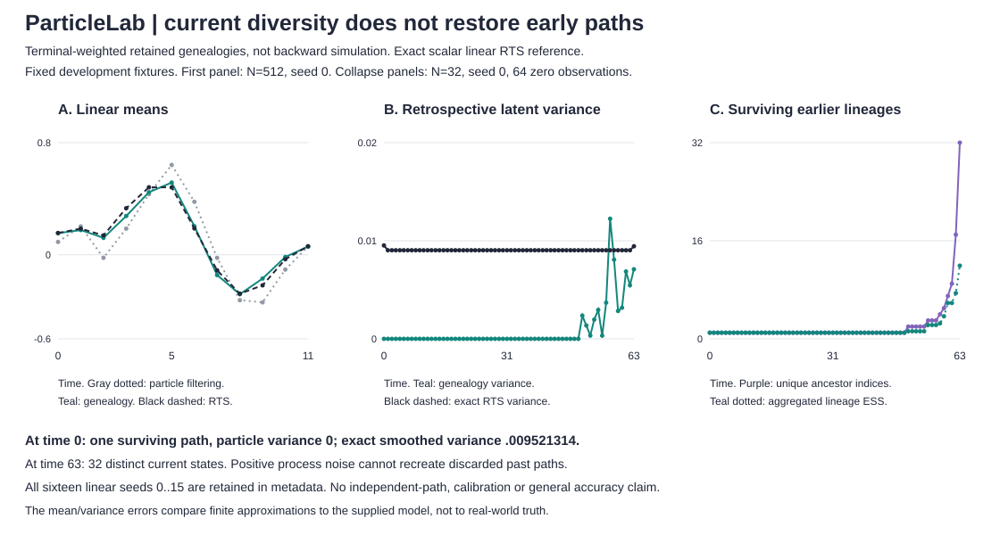

# Retained paths are not recovered paths

`filter` uses only observations through the current time. `smooth` revisits earlier states using the complete supplied observation sequence. It reconstructs the ancestral paths already present in one bootstrap-filter run and weights every path by its terminal filtering weight. It does not simulate new backward paths or repair missing ancestors.

`rts` is a separate exact scalar linear-Gaussian fixed-interval reference in floating point. It is not valid for square observations. Both commands use the same initial-at-t0 convention and strict six-field model payload as `filter`.

## Run

```sh
python -m particlelab smooth examples/sequence.json --particles 512 --seed 0
python -m particlelab smooth examples/square.json --particles 32 --observation square
python -m particlelab rts examples/sequence.json
python examples/smoothing_audit.py > /tmp/smoothing-audit.json
python examples/render_smoothing.py /tmp/smoothing-audit.json --check
```

The `smooth` flags have the same bounds/defaults as `filter`: particles 256 by default, local seed 0, ESS threshold fraction .5 and linear observations. The same model and `N*T <= 65536` caps apply. `rts` has no particle, seed, ESS or square-observation options. Invalid inputs exit 2 with a prefixed stderr error. No online forecast should be evaluated against smoothed values as though future observations were already available.

## Which indices and weights?

At time t, `parent_indices[j]` maps carried particle j after resampling back to its filtered particle index before resampling. The next transition propagates carried index j into filtered index j at time t+1. Without resampling the map is the identity.

Start with every terminal **filtered** index i, not the final carried population. Its weight is `filtered_weights[i]` at the terminal time. Walk backward: if the current descendant index is j at t+1, its filtered ancestor at t is `parent_indices_t[j]`. Read that ancestor's filtered state. Repeat to time 0.

Each reconstructed trajectory keeps its terminal weight at every earlier time. This is a finite weighted approximation to the joint posterior p(x0:T | y0:T). The time-t mean and variance are the weighted moments of that trajectory column. Final resampling is deliberately ignored: it would add another sampling perturbation to an already weighted terminal marginal. No new random numbers are drawn during reconstruction. The embedded `filter` output is identical to a direct call with the same settings.

Output from `genealogy_smoother(data, **filter_settings)`:

- `filter`: complete original run, including its final resampling decision.
- `terminal_weights`: an independent copy of terminal filtered weights.
- `trajectories`: N lists of T states, one per terminal filtered index. They are weighted and dependent, not independent posterior samples.
- `lineage_indices_by_time`: T lists mapping each terminal index to its filtered ancestor index at that time.
- `smoothing_history`: weighted mean, variance and negative/zero/positive sign masses; aggregated weight on every ancestor index; raw and positive-mass lineage counts; distinct state values and lineage weight ESS.

Lineage weight ESS is `1 / sum(aggregated_ancestor_weight²)`. It is different from terminal particle weight ESS. Raw lineage counts include paths whose terminal probability underflowed to zero. Positive-mass counts expose that distinction. Neither count nor ESS is an accuracy or convergence certificate. Indices distinguish labels; equal state values may have different labels.

With no resampling every lineage map is the identity, but earlier states still receive the **final** weights, not their old filtering weights. With resampling, multiple terminal particles can share the same early path. Positive process noise may diversify current states without recreating their discarded earlier paths. This is the limitation the new fixture exposes.

## Linear RTS reference

For filtered mean m and variance P at time t, let the next predictive mean be a*m and variance V = a²*P + q². The scalar backward gain is G = P*a/V when V>0. Starting from the final filtered marginal, use:

```text
smoothed_mean_t = filtered_mean_t + G * (smoothed_mean_next - a*filtered_mean_t)
smoothed_variance_t = P*q²/V + G²*smoothed_variance_next
```

The second expression adds the conditional variance and the propagated next smoothed variance. It is algebraically the usual RTS covariance recursion but avoids subtracting nearly equal variances. The code multiplies the propagated variance in a factored order. For q=0 and a!=0 the transition is deterministic but the earlier state can remain uncertain. For a=0 and q=0 the next state is exactly zero and conveys no information about the earlier random state; use gain 0 and retain its filtered variance. A nonzero a whose predictive variance underflows to zero is rejected, not interpreted as an independent transition. Other nonfinite recursion results are rejected. Floating point is still a limit.

`rts(data, **model_settings)` returns smoothed `history` and the original Kalman `filter`. The terminal mean/variance exactly match filtering. The final backward gain is null because there is no next time. No cross-time covariance or joint Gaussian sampler is returned.

## Fixed development results

The unchanged twelve-point linear payload uses N=512 and **all sixteen seeds 0..15**. The figure shows seed 0 without selecting for fit. The mean of per-seed time-averaged smoothing mean RMSEs versus RTS is .0299202464; the variance RMSE average is .0137440904. Complete per-seed errors and initial lineage counts are in the audit JSON and SVG metadata. These are model-conditional approximation errors, not real-world prediction scores, confidence intervals or evidence that smoothing improves a finite particle estimate. Filtering and smoothing have different targets.

The new path-collapse fixture was the first one inspected: 64 zero observations, a=.9, process std=.4, observation std=.1, initial mean 0/std 2, N=32, seed 0, ESS threshold fraction 1. Its parameters were fixed for development, not held out; no seed or budget search was performed for this fixture.

| Quantity | Time 0, using all 64 observations | Time 63, terminal filtered target |
|---|---:|---:|
| Distinct retained ancestor indices | 1 | 32 |
| Distinct retained state values | 1 | 32 |
| Genealogy mean | -.144240045570 | -.013562329532 |
| Genealogy latent variance | 0 | .007090951020 |
| Exact RTS latent variance | .009521314035 | .009437076501 |
| Aggregated lineage weight ESS | 1 | 11.9351958251 |

The early particle variance is zero because every surviving path passes through one initial particle. The exact smoothed variance remains positive. All 32 terminal states are distinct because later process noise creates current diversity, not lost past paths. This is a descriptive finite-run counterexample, not a causal comparison of resampling policies or a general rate/accuracy statement.



All twelve means in panel A and all 64 variance/count/lineage-ESS values in panels B/C are plotted with fixed domains. The audit settings, every series, all sixteen linear-seed errors, endpoint diagnostics and selection limits are embedded in SVG metadata. Regeneration rejects changed fixtures, missing points and out-of-domain values rather than clipping them. Panel A's gray filtering series has a different information set from the two smoothing series; it is not a baseline accuracy ranking.

## Validation and limits

Twenty new tests bring the suite to 74. A separate tiny dense joint-Gaussian conditioning calculation verifies RTS for positive, negative, zero and deterministic transition settings. Other tests check static conjugate posteriors, terminal identity, future-observation effects, variance bounds/reflection, underflow guards and extreme supported inputs. Genealogies are checked against an independent forward history-copy algorithm, manual weighted moments, parent/root mappings, no-resampling identities, ignored final resampling, square sign masses, RNG isolation, repeatability and mutation isolation. CLI routes and all 292 SVG point coordinates/values are checked.

Reconstruction uses O(T*N) time and memory, in addition to the retained filter history. RTS uses O(T) time/memory. Returned full trajectories and mappings increase output size by a constant multiple. These are finite scalar supplied-model calculations. No parameter fitting, state rejuvenation, backward-simulation smoother, fixed-lag approximation, independent posterior trajectories, calibrated intervals, real-data accuracy or high-dimensional claim. The square-observation genealogy option remains a finite approximation without an exact dynamic nonlinear reference.

Independent implementations of standard retained-history SIR smoothing and scalar RTS equations. Technical reference: Simo Särkkä and Lennart Svensson, *Bayesian Filtering and Smoothing*, second edition (2023), sections 12.2 and 15.1. [Author-hosted reference](https://users.aalto.fi/~ssarkka/pub/bfs_book_2023_online.pdf). No book text, code or figures are included. The bootstrap-filter attribution and its differences remain in the README.
