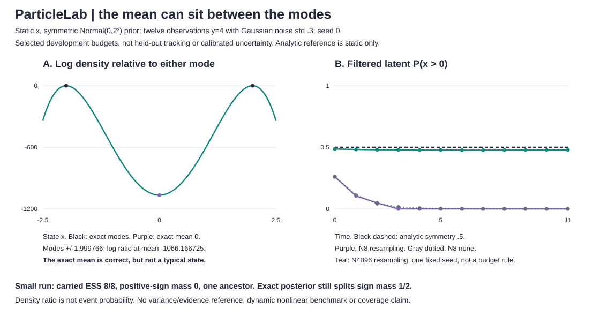

# Static square-observation symmetry audit

[Runnable overview](README.md) · [API and CLI](#run-it)

## Narrow reference, explicit assumptions

`static_square_reference(data, observation_std=.5, initial_std=2.)` fixes one shared state x across all observations: a=1, process std=0, initial mean=0, x ~ Normal(0,tau²), and independent yᵢ | x ~ Normal(x²,r²). Both standard deviations are positive and supplied. This is not a general reference for the dynamic square-observation filter.

The posterior log density, up to an x-independent constant, is:

```text
l(x) = -x²/(2*tau²) - sum_i (y_i - x²)²/(2*r²)
```

It is even and continuous. Therefore E[x | y]=0 and P(x<0 | y)=P(x>0 | y)=1/2, with P(x=0 | y)=0. A density mode at zero is not positive probability at the single point zero. These statements concern the latent state under the supplied model, not event confidence or calibrated real-world uncertainty.

For n observations with mean ybar, set:

```text
c = ybar - r²/(2*n*tau²)
```

If c>0, the two global modes are `+/-sqrt(c)`. Completing the quartic square gives:

```text
l(x) - l(mode) = -n*(x²-c)²/(2*r²)
l(0) - l(mode) = -n*c²/(2*r²)
```

If c<=0, the unique global mode is zero, including the flat quartic case c=0, and the mean-to-mode log-density ratio is zero. Each returned prefix reports the observation mean, exact symmetry summaries, mode locations, squared mode magnitude and log density at zero relative to a mode. No numerical integration is used. **No posterior variance, evidence or normalized density is returned.** Analytic formulas are evaluated in floating point; near c=0 rounding can change the reported mode count.

## Run it

```sh
python -m particlelab square-reference examples/square.json
python -m particlelab filter examples/square.json --observation square --particles 8 --seed 0 --ess-fraction 1
python examples/square_audit.py > /tmp/square-audit.json
python examples/render_square.py /tmp/square-audit.json --check
```

The CLI still requires the complete six-field model payload. `square-reference` rejects any a other than 1, process std other than 0 or initial mean other than 0, including booleans that compare equal to these constants. The Python API omits these fields because the reference fixes them. Other input bounds match the main model. Prefix means use `math.fsum` on each prefix: O(T²) work and O(T) result storage, bounded by T<=80.

The particle filter now retains `filtered_sign_mass` and `carried_sign_mass` dictionaries at every time. Each has negative/zero/positive probability, computed from particles and weights before or after resampling. These are marginal sign masses, not independent state draws or path probabilities. A finite particle approximation can have an atom at zero; the continuous analytic reference does not. Adding these summaries changes no random draws, weights, particles, moments, evidence or resampling decisions. All prior numerical fields and the original SVG are regression-checked unchanged.

## Selected fixed-seed support-loss example

Twelve observations all equal to 4, observation std .3, initial std 2, with the restricted static model above. The exact posterior retains sign mass .5 and mean 0 at every prefix. Its final modes are **+/-1.9997656112654802**, and log density at the mean relative to either mode is **-1066.1667252604166**. The density ratio underflows if exponentiated, but the log remains finite. The correct posterior mean is in a density valley, not a typical state or a mode.

| Final quantity | N=8, resampling fraction 1 | N=8, no resampling | N=4096, resampling fraction 1 | Analytic reference |
|---|---:|---:|---:|---:|
| Filtered P(x>0) | 0 | .00000371680487 | .478163410122 | .5 |
| Carried P(x>0) | 0 | .00000371680487 | .479248046875 | not applicable |
| Filtered mean | -2.03269778838 | -2.03268323289 | -.0885235753671 | 0 |
| Carried ESS | 8 | 1.00000743364 | 4096 | not applicable |
| Initial labels carried | 1 | 8 | 154 | not applicable |

All three runs use seed 0 and identical observations/parameters. During development, seed-0 budgets 8/16/32/64/512/4096 were inspected on repeated y=4; N=8 and N=4096 with a common twelve-observation horizon were retained, plus the N=8 no-resampling comparison. The small-budget sign-loss example was selected after inspection. This is not a held-out budget ranking, a recommendation to use 4096 particles or a comparison that isolates resampling as a general causal mechanism. Larger budgets change the finite initial sample and subsequent RNG stream. No process noise means resampling cannot regenerate lost sign support.

The N=8 no-resampling run retains a tiny nonzero positive-sign mass, yet is also far from the analytic .5. The selected larger run retains both signs but is still a random approximation, not an exact or calibrated posterior. A full post-resampling weight ESS does not mean either sign mass or mean is right.



Panel A evaluates the analytic quartic log-density ratio at 101 display states in [-2.5,2.5], plus exact mode/mean markers. It is not grid-based posterior inference or a normalized density plot. Panel B preserves all twelve filtered sign-probability points from every selected run. Carried probabilities, ESS and ancestry remain in numeric metadata/audit JSON. Fixed domains and fixture/consistency guards reject changed or incomplete data rather than clipping it silently.

## Validation and limits

Sixteen new tests bring the suite to 54. Independent direct log-joint evaluation checks density ratios; derivatives and neighbor values check modes; positive/negative state pairs check evenness; unimodal and flat-threshold cases, finite underflow logs and extreme inputs are covered. Filtered/carried sign masses are checked directly from trace particles/weights, including zero atoms. CLI fixed-model restrictions/booleans, deterministic audit reproduction, every plotted sign coordinate, all 101 analytic curve coordinates and exact marker geometry are checked.

This validates a restricted static analytical case and finite selected particle runs. It does not establish dynamic nonlinear tracking quality, posterior variance/evidence correctness for square observations, smoothing, robustness, convergence, calibrated coverage or real-data performance. The figure's mean-at-a-valley observation does not make the mean an incorrect expectation. It shows why a correct scalar expectation can be an unrepresentative state summary.
